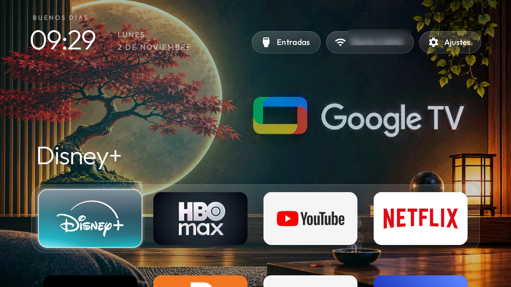
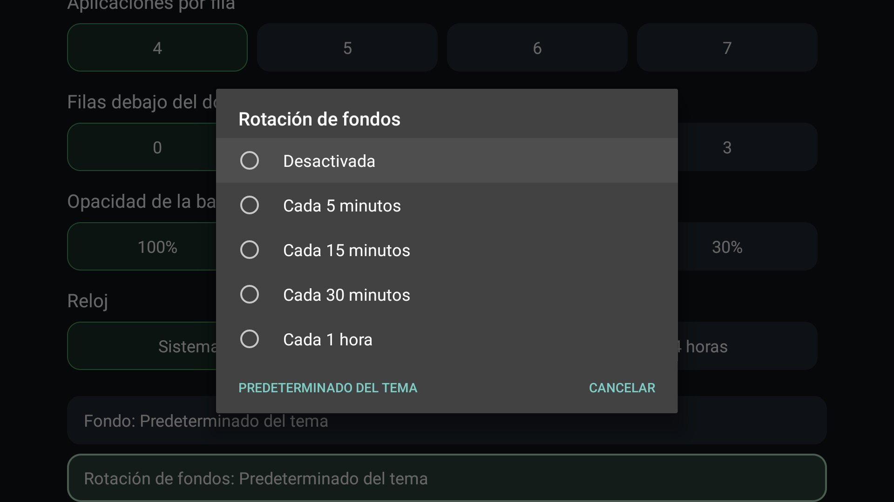
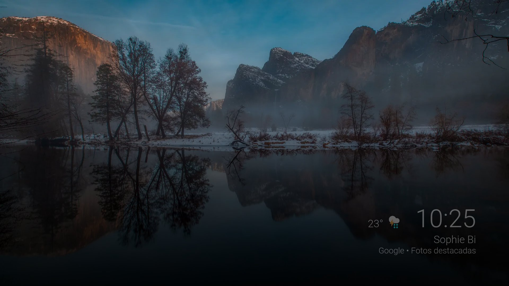

# Guía Completa de Personalización de CleanYourTV

Esta guía reúne todas las opciones, modificadores e interruptores (*switches*) disponibles en el launcher para personalizar cualquier televisor. Sirve como referencia para futuras instalaciones y configuraciones.

---

## 📌 Reglas Fijas para Nuevas Instalaciones

Cada vez que se inicie la configuración de un nuevo televisor, se deben definir dos preguntas fundamentales:

1. **Botón de reorganizar el cajón de apps (`reorder_button`)**:
   * **¿Mostrarlo en la barra superior?**
     * `true`: Muestra el icono de flechas `⇅` entre Wi-Fi y Ajustes.
     * `false`: Oculta el botón dejando la barra superior limpia. *(El reordenamiento de apps sigue disponible manteniendo presionado `OK` sobre el botón de Ajustes o sobre cualquier icono)*.
2. **Animaciones del launcher (`animations`)**:
   * **¿Activar animaciones?**
     * `true`: Transiciones elásticas suaves, desplazamientos fluidos y efectos visuales al navegar.
     * `false` (o `reduced_motion: true`): Respuesta instantánea sin demoras ni transiciones, ideal para televisores con chipsets básicos o usuarios que prefieren máxima inmediatez.
3. **Protector de pantalla (Screensaver de Paisajes)**:
   * **Mantener siempre habilitado el protector de paisajes** (`com.google.android.backdrop`): No debe deshabilitarse nunca durante el debloat. Protege la pantalla mostrando paisajes rotativos de Google tras 5 minutos de inactividad, liberando la memoria en cuanto se pulsa una tecla.

---

## 1. Barra Superior y Cabecera (Top Bar)

| Opción (`config.json`) | Tipo | Descripción |
|---|---|---|
| `"reorder_button"` | `bool` | Muestra (`true`) u oculta (`false`) el botón `⇅` en la barra superior. |
| `"show_network_pill"` | `bool` | Muestra (`true`) u oculta (`false`) la píldora de estado de red Wi-Fi / Ethernet. |
| `"show_inputs_pill"` | `bool` | Muestra (`true`) u oculta (`false`) el selector de entradas HDMI / AV. |
| `"icon_only_buttons"` | `bool` | Convierte Wi-Fi y Ajustes en círculos minimalistas con solo el icono, sin texto. |
| `"top_bar_apps"` | `list` | Agrega accesos directos circulares en la barra superior para abrir apps directamente. |
| `"top_menu"` | `bool` | Unifica Entradas, Wi-Fi y Ajustes en un único botón de engranaje flotante en el centro. |
| `"wifi_status_color"` | `bool` | El icono de Wi-Fi se ilumina en verde cuando la tele tiene internet. |
| `"wifi_status_warnings"` | `bool` | Muestra naranja si hay Wi-Fi sin internet, y rojo si está desconectado. |
| `"show_greeting"` | `bool` | Muestra (`true`) u oculta (`false`) el saludo "Buenos días / tardes" sobre el reloj. |
| `"greeting_name"` | `string` | Agrega un nombre propio al saludo (ej. `"Familia"`, `"Living"`). |
| `"clock_format"` | `string` | Formato del reloj: `"12"`, `"24"` o `"system"` (sigue el ajuste del televisor). |
| `"date_below_clock"` | `bool` | Mueve la fecha debajo del reloj para dejar más espacio libre a la derecha. |
| `"show_stats"` | `bool` | Muestra una línea discreta con consumo de CPU, memoria RAM libre y almacenamiento libre. |

### Visualización

#### Barra superior limpia sin botón de reorganizar (`reorder_button: false`)


#### Accesos directos a apps en la barra superior (`top_bar_apps: ["com.google.android.youtube.tv"]`)


#### Fecha ubicada debajo del reloj (`date_below_clock: true`)


#### Alertas de estado de Wi-Fi (`wifi_status_warnings: true`)


#### Monitor de estadísticas del sistema en vivo (`show_stats: true`)


---

## 2. Dock y Cuadrícula de Aplicaciones (Layout & Apps)

| Opción (`config.json`) | Tipo | Descripción |
|---|---|---|
| `"columns"` | `int (4-8)` | Cantidad de apps por fila. Con 4 se ven grandes; con 6 u 8 entran muchas más. |
| `"rows_below_dock"` | `int (0-3)` | Cuántas filas de la cuadrícula se ven debajo del dock (`0` = minimalista puro). |
| `"dock_apps"` | `list` | Lista de paquetes de apps fijadas en el dock en el orden deseado. |
| `"hidden_apps"` | `list` | Lista de paquetes que se ocultan totalmente de la pantalla principal. |
| `"dock_glass"` | `bool` | Aplica efecto de cristal esmerilado translúcido al fondo del dock. |
| `"dock_band"` | `bool` | Si es `false`, elimina la banda del dock; las apps flotan sobre el wallpaper. |
| `"dock_opacity"` | `int (30-100)`| Porcentaje de opacidad del dock (100%, 70%, 50% o 30%). |
| `"dock_title"` | `bool` | Muestra el nombre grande de la app destacada sobre el dock. |
| `"always_show_names"`| `bool` | Si es `true`, muestra los títulos debajo de todas las apps, no solo la enfocada. |
| `"uniform_tiles"` | `bool` | Convierte banners desparejos en tarjetas uniformes del color de cada app. |
| `"single_row"` | `bool` | Modo de fila única: todas las apps se desplazan horizontalmente en el dock. |
| `"tile_menu"` | `bool` | Abre menú al mantener presionado OK: Mover de lugar, Quitar o Info de app. |

### Visualización

#### Cuadrícula de 6 columnas (`columns: 6`)


#### Tarjetas uniformes con icono centrado (`uniform_tiles: true`)


#### Fila única horizontal sin cuadrícula debajo (`single_row: true`)


#### Dock sin franja ni recuadro (`dock_band: false`)


#### Menú de mover y organizar apps (`tile_menu: true`)


---

## 3. Fondos de Pantalla (Wallpapers)

| Opción (`config.json`) | Tipo | Descripción |
|---|---|---|
| `"wallpaper"` | `bool` | Activa (`true`) o desactiva (`false`) el uso de fondos de pantalla. |
| `"wallpaper_rotation_minutes"` | `int` | Intervalo de rotación automática en minutos (ej. 15, 30, 60 min). `0` desactiva rotación. |
| `"wallpaper_order"` | `string` | `"shuffle"` (aleatorio inteligente sin repetir) o `"sequential"` (por nombre de archivo). |
| `"wallpaper_dim"` | `int (0-90)`| Sombra negra sobre el wallpaper (en %) para garantizar lectura del texto blanco. |
| `"wallpaper_captions"` | `bool` | Muestra en una esquina el nombre del fondo tomado de `captions.txt`. |
| `"sky_intensity"` | `int (0-100)`| Agrega un cielo dinámico sutil detrás que cambia con las horas del día. |

> **Nota técnica de formato**:
> * **Formato óptimo**: WebP (`.webp`), calidad 85. Reduce un 75% el peso respecto a PNG sin pérdida perceptible.
> * **Resolución recomendada**: `1920 × 1080` (Full HD). Ideal para TVs de 50" a 80" debido a que la UI de Android TV renderiza internamente a 1080p y el hardware escala a 4K, ahorrando memoria RAM.

### Visualización

#### Control de rotación de fondos desde la tele (Ajustes del Launcher)


#### Rotación de paisajes y fondos ilustrados


#### Cielo dinámico según la hora del día (`sky_intensity: 60`)


---

## 4. Animaciones, Enfoque y Resplandor (Motion & Glow)

| Opción (`config.json`) | Tipo | Descripción |
|---|---|---|
| `"animations"` | `bool` | Activa (`true`) o apaga (`false`) las animaciones generales. |
| `"reduced_motion"` | `bool` | Movimiento reducido para máxima velocidad en TVs lentas. |
| `"advanced_effects"` | `bool` | Efectos avanzados: zoom del icono enfocado y elevación de la tarjeta. |
| `"focus_overshoot"` | `bool` | El cursor rebota suavemente al frenar (`true`) o va recto sin rebotar (`false`). |
| `"ambient_glow"` | `bool` | Resplandor del color de la app detrás del dock (`true` o `false`). |
| `"app_glow"` | `bool` | Ilumina el marco de cada tarjeta con el color propio de la app. |
| `"glass_style"` | `string` | Estilo del foco: `"glass"` (bloque brillante), `"rim"` (borde fino) o `"halo"` (resplandor). |

### Visualización

#### Estilo de enfoque de borde sutil (`glass_style: "rim"` o `"halo"`)


#### Tema estilo cine oscuro con resplandor suave (`themes/cinematic`)


---

## 5. Control Remoto y Comportamiento del Sistema

| Opción (`config.json`) | Tipo | Descripción |
|---|---|---|
| `"open_on_start_choice"` | `bool` | Agrega opción en Ajustes para elegir qué app abre la TV al encender. |
| `"open_on_start_network_wait"` | `int` | Segundos a esperar que conecte el Wi-Fi antes de abrir la app al encender. |
| `"boot_to_live_tv"` | `bool` | Abre directamente la televisión en vivo al encender la TV. |
| `"home_idle_clock_minutes"` | `int` | Minutos de inactividad para activar el salvapantallas de reloj flotante (`0` = apagado). |
| `"back_opens_clock"` | `bool` | Presionar el botón Atrás en el Home activa el reloj en pantalla completa. |
| `"clock_wallpaper"` | `bool` | El reloj flotante se dibuja sobre el wallpaper actual en vez de fondo negro. |
| `"app_keys"` | `list` | Reasigna botones del control remoto para abrir apps o funciones específicas. |

### Visualización

#### Protector de pantalla con paisajes rotativos en alta definición (Google Backdrop)


#### Salvapantallas de reloj flotante minimalista


#### Reloj sobre el wallpaper actual (`clock_wallpaper: true`)


#### Menú para iniciar en una app al encender (`open_on_start_choice: true`)


---

## 🛠️ Ejemplo de Configuración Modelo (`config.json`)

Para armar un tema personalizado para una TV, basta con crear un archivo `config.json` con las claves que se deseen aplicar:

```json
{
  "reorder_button": false,
  "animations": true,
  "advanced_effects": false,
  "columns": 4,
  "rows_below_dock": 0,
  "dock_glass": true,
  "dock_opacity": 70,
  "ambient_glow": true,
  "wallpaper": true,
  "wallpaper_rotation_minutes": 60,
  "wallpaper_dim": 20,
  "wallpaper_order": "shuffle",
  "home_idle_clock_minutes": 5,
  "clock_wallpaper": true,
  "wifi_status_color": true,
  "dock_apps": [
    "com.disney.disneyplus",
    "com.wbd.stream",
    "com.google.android.youtube.tv",
    "com.netflix.ninja"
  ],
  "hidden_apps": [
    "com.android.tv.settings",
    "com.siliconworks.firmware"
  ]
}
```

Para aplicarlo a cualquier televisor:
```bash
TV_HOST=<ip_de_la_tele> tools/theme.sh <carpeta_del_tema>
```

